# kaii-agent

kaii-agent 是一个面向 macOS 的 AI 桌面助手。它参考 Claude Code、Codex 等主流 AI 工具中常见的对话、文件处理和任务执行方式，加入写作画布、知识库、批量处理、定时任务和剪贴板工具，把日常会用到的功能放进同一个窗口。

kaii-agent is an AI desktop assistant for macOS. It draws on common approaches to conversation, file handling, and task execution in mainstream AI tools such as Claude Code and Codex, and adds a writing canvas, knowledge libraries, batch processing, scheduled tasks, and clipboard tools to bring everyday functions into one window.

你可以使用自己的 API key 接入 DeepSeek、智谱 GLM 和 Kimi，也可以通过 llama.cpp 运行本机 GGUF 模型。希望接入其他服务时，可以沿着现有模型接口继续扩展。

You can connect DeepSeek, Zhipu GLM, and Kimi with your own API keys, or run local GGUF models through llama.cpp. To connect other services, you can extend the existing model interfaces.

项目处于早期开发阶段，已经提供对话、资料阅读、写作和任务处理等基础功能。安装体验、兼容性和交互细节会继续完善。

The project is in early development and already provides core functions for conversation, reading materials, writing, and task processing. Installation, compatibility, and interaction details will continue to improve.

## 完整功能与操作清单

Complete feature and operation list

下表完整列出 14 类、301 项功能、操作及维护能力，按使用场景分类。标有“待真机验证”的条目已有实现，仍需补齐相应的桌面端验证。涉及模型生成的操作使用所选模型，定时任务在 kaii-agent 运行期间执行。

The tables below list all 301 features, operations, and maintenance capabilities across 14 categories, grouped by use case. Items marked “Native testing pending” have been implemented and still need the corresponding desktop validation. Operations that generate content use the selected model, and scheduled tasks run while kaii-agent is running.

### 01 模型与接入

Models and connections

| 编号<br>ID | 功能与操作<br>Feature or operation |
| --- | --- |
| M01 | DeepSeek API key 接入<br>Connect with a DeepSeek API key |
| M02 | 智谱 GLM API key 接入<br>Connect with a Zhipu GLM API key |
| M03 | Kimi API key 接入<br>Connect with a Kimi API key |
| M04 | llama.cpp 与本机 GGUF 模型接入<br>Connect llama.cpp and local GGUF models |
| M05 | 首次使用配置模型服务<br>Configure a model service on first use |
| M06 | 跳过配置，先浏览界面<br>Skip setup and browse the interface |
| M07 | 手动选择服务商和模型<br>Select a provider and model manually |
| M08 | 按任务自动选择模型并显示理由<br>Select a model automatically for the task and display the reason |
| M09 | 刷新云端模型清单<br>Refresh cloud model lists |
| M10 | 保存、更换、删除 API key 及掩码显示<br>Save, replace, delete, and display masked API keys |
| M11 | 启动、停止和重启本机模型<br>Start, stop, and restart the local model |
| M12 | 配置模型路径、端口和上下文长度<br>Configure the model path, port, and context length |
| M13 | 配置温度、回答长度及单次长度覆盖<br>Configure temperature, response length, and per-response length overrides |
| M14 | 配置回答超时和启动时加载模型<br>Configure response timeouts and model loading at startup |
| M15 | 显示模型状态、进程内存和启动错误<br>Display model status, process memory, and startup errors |
| M16 | 对符合条件的网络故障尝试模型回退<br>Attempt a model fallback for eligible network failures |
| M17 | 两个或三个模型并排回答<br>Compare responses from two or three models side by side |
| M18 | 比较页显示回答耗时和生成速度<br>Display response time and generation speed in comparisons |
| M19 | 选用比较结果继续对话<br>Choose a comparison result and continue the conversation |
| M20 | 取消正在进行的模型比较<br>Cancel an active model comparison |

### 02 输入与提问

Input and questions

| 编号<br>ID | 功能与操作<br>Feature or operation |
| --- | --- |
| I01 | 各段对话分别保存草稿并在重开后恢复<br>Save separate conversation drafts and restore them when reopening |
| I02 | 上下键调出本段历史提问<br>Recall questions from the current conversation with the arrow keys |
| I03 | 拉大输入框编辑长问题<br>Expand the composer to edit longer questions |
| I04 | 粘贴剪贴板图片<br>Paste an image from the clipboard |
| I05 | 一次拖入多个文件<br>Drag in multiple files at once |
| I06 | 同时附带多份文档<br>Attach multiple documents to a question |
| I07 | 用 @ 选择已保存的网页<br>Select a saved web page with @ |
| I08 | 用 @ 选择工作区文件<br>Select a workspace file with @ |
| I09 | 插入常用语及用 / 搜索提示词<br>Insert saved prompts and search them with / |
| I10 | 提示词变量填充<br>Fill variables in prompt templates |
| I11 | 将历史提问存成常用语<br>Save a previous question as a reusable prompt |
| I12 | 语音听写与语言选项<br>Voice dictation and language options |
| I13 | 超长问题或可写工程任务的发送前确认<br>Confirm before sending very long questions or writable engineering tasks |
| I14 | 显示输入字数与粗略 token 估计<br>Display input length and an approximate token estimate |
| I15 | 清理空白、全角字符和中英文间距<br>Clean up whitespace, full-width characters, and spacing between Chinese and English |
| I16 | JSON 缩进排版<br>Format JSON indentation |
| I17 | 输入框内插入粗体和行内代码标记<br>Insert bold and inline-code markup in the composer |
| I18 | 粘贴文字后直接发送的快捷键<br>Keyboard shortcut to paste text and send it directly |
| I19 | 长按发送临时切换本轮联网状态<br>Hold Send to temporarily change web access for that turn |
| I20 | 显示附件总字数、图片尺寸和上限提示<br>Display total attachment text length, image dimensions, and limit notices |
| I21 | 单独移除或清空待发附件<br>Remove one pending attachment or clear them all |
| I22 | 双按 Esc 清空输入框<br>Double-press Esc to clear the composer |

### 03 对话与记录

Conversations and history

| 编号<br>ID | 功能与操作<br>Feature or operation |
| --- | --- |
| C01 | 新建对话与自动生成标题<br>Create conversations and generate titles automatically |
| C02 | 从侧栏或顶栏修改对话名称<br>Rename a conversation from the sidebar or title bar |
| C03 | 流式回答及模型返回的思考内容<br>Streaming responses and reasoning content returned by models |
| C04 | 显示回答模型和生成耗时<br>Display the response model and generation time |
| C05 | 停止生成并保留已收到的内容<br>Stop generation and retain the content already received |
| C06 | 编辑问题后重新发送<br>Edit a question and send it again |
| C07 | 原样重问上一条问题<br>Ask the previous question again unchanged |
| C08 | 重新生成回答<br>Regenerate a response |
| C09 | 要求更短或更详细的回答<br>Request a shorter or more detailed response |
| C10 | 选中文字引用追问<br>Select text and quote it in a follow-up question |
| C11 | 从回答处分支为新对话并显示来源<br>Branch into a new conversation from a response and display its source |
| C12 | 合并两段对话<br>Merge two conversations |
| C13 | 对话置顶与取消置顶<br>Pin and unpin conversations |
| C14 | 对话标签与多标签筛选<br>Tag conversations and filter by multiple tags |
| C15 | 对话归档与恢复<br>Archive and unarchive conversations |
| C16 | 批量归档长期未使用的对话<br>Archive older inactive conversations in a batch |
| C17 | 删除对话后放入回收站<br>Move deleted conversations to Trash |
| C18 | 搜索、恢复或清空回收站<br>Search, restore from, or empty Trash |
| C19 | 确认后删除一轮问答<br>Delete one question-and-answer turn after confirmation |
| C20 | 收藏回答、搜索收藏并返回原对话<br>Favorite responses, search favorites, and return to their conversations |
| C21 | 当前对话的收藏跳转条<br>Navigation strip for favorites in the current conversation |
| C22 | 对话全文搜索、命中高亮与项目分组<br>Search conversation text, highlight matches, and group results by project |
| C23 | 对话内查找及上下个结果导航<br>Find text within a conversation and navigate between matches |
| C24 | 生成和移除对话摘要<br>Generate and remove conversation summaries |
| C25 | 显示轮数、字数、创建时间和用过的模型<br>Display turn count, text length, creation time, and models used |
| C26 | 消息时间、轮次和跨日期分隔<br>Message timestamps, turn numbers, and date separators |
| C27 | 记住当前对话与滚动位置<br>Remember the active conversation and scroll position |
| C28 | 恢复最近关闭的对话<br>Reopen the most recently closed conversation |
| C29 | 继续上次或今日之前最近的对话<br>Resume the previous conversation or the last one before today |
| C30 | 临时对话与对话级备份排除<br>Temporary conversations and per-conversation backup exclusions |
| C31 | 从 ChatGPT 导出文件导入对话<br>Import conversations from a ChatGPT export file |

### 04 回答展示与导出

Response display and export

| 编号<br>ID | 功能与操作<br>Feature or operation |
| --- | --- |
| R01 | Markdown 正文、列表和表格<br>Markdown text, lists, and tables |
| R02 | 数学公式显示与 LaTeX 复制<br>Render mathematical formulas and copy LaTeX |
| R03 | 代码语法高亮<br>Code syntax highlighting |
| R04 | 代码行号与自动换行<br>Code line numbers and line wrapping |
| R05 | 长代码折叠与展开<br>Collapse and expand long code blocks |
| R06 | 复制代码块与行内代码<br>Copy code blocks and inline code |
| R07 | 按语言后缀保存代码文件<br>Save code files with extensions based on the language |
| R08 | 独立代码内容面板<br>Dedicated code artifact panel |
| R09 | 长回答目录导航<br>Outline navigation for long responses |
| R10 | 回答字数与预计阅读时间<br>Response text length and estimated reading time |
| R11 | 来源链接与悬停摘要<br>Source links and hover summaries |
| R12 | 查看链接完整网址并复制<br>View a link's full URL and copy it |
| R13 | 表格排序与行列数显示<br>Sort tables and display row and column counts |
| R14 | 表格复制为 TSV 或导出 CSV<br>Copy tables as TSV or export them as CSV |
| R15 | 柱状图、折线图和饼图<br>Bar charts, line charts, and pie charts |
| R16 | 切换柱状图与折线图<br>Switch between bar and line charts |
| R17 | 展开图表数据并导出 CSV<br>Expand chart data and export it as CSV |
| R18 | 浅色与深色图表配色<br>Light and dark chart palettes |
| R19 | 复制原格式或纯文本回答<br>Copy a response with its markup or as plain text |
| R20 | 拖出回答到其他应用<br>Drag a response into another application |
| R21 | 整段对话复制<br>Copy a complete conversation |
| R22 | 对话导出 Markdown、纯文本和 HTML<br>Export conversations as Markdown, plain text, and HTML |
| R23 | 对话导出 Word 和 PDF<br>Export conversations as Word and PDF |
| R24 | 隐藏附件文件名的 PDF 导出选项<br>PDF export option that omits attachment filenames |
| R25 | 全部对话按独立 Markdown 文件打包为 ZIP<br>Package all conversations as separate Markdown files in a ZIP archive |
| R26 | 项目内对话合并导出 Markdown 或 PDF<br>Export a project's conversations together as Markdown or PDF |

### 05 文档与图片

Documents and images

| 编号<br>ID | 功能与操作<br>Feature or operation |
| --- | --- |
| D01 | PDF 文本提取<br>Extract text from PDFs |
| D02 | Word 文档文本读取<br>Read text from Word documents |
| D03 | 文本和 Markdown 文件读取<br>Read text and Markdown files |
| D04 | CSV 和 Excel 表格读取<br>Read CSV and Excel spreadsheets |
| D05 | 在 Excel 文件中选择工作表<br>Select a worksheet in an Excel file |
| D06 | 文档内容预览，待真机验证<br>Document text preview, native testing pending |
| D07 | 提取并查看文档目录<br>Extract and view a document outline |
| D08 | 选择章节作为提问材料<br>Select a section to use in a question |
| D09 | 搜索文档内关键词<br>Search for keywords within a document |
| D10 | 跨对话复用已解析文档<br>Reuse parsed documents across conversations |
| D11 | 显示文档解析错误<br>Display document parsing errors |
| D12 | 从文字创建资料附件<br>Create a material attachment from text |
| D13 | 图片文字识别<br>Recognize text in images |
| D14 | 支持图片输入的模型接收原图<br>Send original images to models that support image input |
| D15 | 使用系统截图选择图像区域<br>Use system screenshot controls to select an image region |
| D16 | 查看图片及其尺寸<br>View images and their dimensions |
| D17 | 复制完整 OCR 文字<br>Copy the complete OCR text |
| D18 | 图片另存为本机文件<br>Save an image as a local file |

### 06 知识库与网页

Knowledge libraries and web pages

| 编号<br>ID | 功能与操作<br>Feature or operation |
| --- | --- |
| K01 | 选择资料文件夹建立知识库<br>Create a knowledge library from a selected folder |
| K02 | 拖入文件夹建立知识库，待真机验证<br>Create a knowledge library by dropping a folder, native testing pending |
| K03 | 管理多个知识库及其启用状态<br>Manage multiple knowledge libraries and their enabled state |
| K04 | 设置索引排除目录<br>Set directories to exclude from indexing |
| K05 | 索引时跳过检测到的密钥内容<br>Skip detected credential content during indexing |
| K06 | 显示索引文件数、总字数和过期状态<br>Display indexed file counts, total text length, and stale status |
| K07 | 重建单个或全部知识库索引<br>Rebuild one or all knowledge indexes |
| K08 | 预览问题命中的文件、段落和摘录<br>Preview the files, passages, and excerpts matched by a question |
| K09 | 将检索片段带入提问并展示引用<br>Include retrieved passages in a question and display citations |
| K10 | 移除知识库索引<br>Remove a knowledge library index |
| K11 | 自动联网检索与来源展示<br>Automatic web search and source display |
| K12 | 配置搜索来源与 SearXNG 地址<br>Configure the search provider and SearXNG endpoint |
| K13 | 可选搜索失败后使用维基百科<br>Optionally fall back to Wikipedia after a search failure |
| K14 | 从网址保存网页正文<br>Save web page text from a URL |
| K15 | 网页摘要，待真机验证<br>Web page summaries, native testing pending |
| K16 | 为网页存档添加标签<br>Add tags to saved web pages |
| K17 | 按标题、摘要和标签搜索存档<br>Search saved pages by title, summary, and tags |
| K18 | 侧栏全局搜索网页存档<br>Find saved web pages through sidebar search |
| K19 | 将网页存档作为提问附件<br>Attach a saved web page to a question |
| K20 | 将网页存档加入知识库<br>Add saved web pages to a knowledge library |
| K21 | 单篇导出 Markdown 或全部打包 ZIP<br>Export one page as Markdown or all pages as ZIP |
| K22 | 打开原始网址和删除网页存档<br>Open original URLs and delete saved web pages |

### 07 写作画布

Writing canvas

| 编号<br>ID | 功能与操作<br>Feature or operation |
| --- | --- |
| W01 | 将单条回答或整段对话的回答放进画布<br>Move one response or a conversation's responses into the canvas |
| W02 | 直接编辑正文<br>Edit the text directly |
| W03 | 选中一段局部改写<br>Rewrite a selected passage |
| W04 | 扩写选中内容<br>Expand selected text |
| W05 | 精简选中内容<br>Shorten selected text |
| W06 | 调整为正式语气<br>Make the tone more formal |
| W07 | 调整为自然易懂的表达<br>Make the wording more natural and accessible |
| W08 | 修正错字、标点和语法<br>Correct typos, punctuation, and grammar |
| W09 | 从选中段落继续写作<br>Continue writing from the selected passage |
| W10 | 为本次改写补充要求<br>Add instructions for the current rewrite |
| W11 | 撤销上一次改写<br>Undo the last rewrite |
| W12 | 查看版本历史并恢复版本<br>View version history and restore a version |
| W13 | 并排比较两个版本<br>Compare two versions side by side |
| W14 | 自动保存和恢复画布草稿<br>Automatically save and restore canvas drafts |
| W15 | 查找和替换文字<br>Find and replace text |
| W16 | 标题大纲导航<br>Navigate by headings in the outline |
| W17 | 全屏写作与 Markdown 预览<br>Full-screen writing and Markdown preview |
| W18 | 显示正文、选区字数和阅读时长<br>Display document and selection text lengths and reading time |
| W19 | 设置字数目标并查看进度<br>Set a text-length target and view progress |
| W20 | 保存术语表并检查用词<br>Save a glossary and check terminology |
| W21 | 检查称呼、数字和表述一致性，待真机验证<br>Check consistency of names, numbers, and statements, native testing pending |
| W22 | 在光标处插入日期<br>Insert the date at the cursor |
| W23 | 复制全文与导出 Markdown、Word<br>Copy all text and export Markdown or Word |
| W24 | 导出 PDF，待真机验证<br>Export PDF, native testing pending |

### 08 项目、记忆与技能

Projects, memory, and skills

| 编号<br>ID | 功能与操作<br>Feature or operation |
| --- | --- |
| P01 | 新建、重命名和删除项目<br>Create, rename, and delete projects |
| P02 | 为项目设置长期背景说明<br>Set persistent background instructions for a project |
| P03 | 为项目指定默认模型<br>Assign a default model to a project |
| P04 | 给项目添加共享资料<br>Add shared materials to a project |
| P05 | 从菜单或拖拽移动对话到项目<br>Move conversations into projects through menus or dragging |
| P06 | 拖拽调整项目顺序<br>Reorder projects by dragging |
| P07 | 项目颜色标记<br>Project color markers |
| P08 | 折叠项目分组并记住状态<br>Collapse project groups and remember their state |
| P09 | 显示项目内对话数量<br>Display the number of conversations in a project |
| P10 | 新增、修改和归档记忆<br>Create, edit, and archive memories |
| P11 | 选择回答时是否使用记忆<br>Choose whether responses use memory |
| P12 | 从对话生成待确认的记忆建议<br>Generate memory suggestions from a conversation for review |
| P13 | 加载技能文件夹<br>Load a skills folder |
| P14 | 新建、编辑和移除自定义技能<br>Create, edit, and remove custom skills |
| P15 | 在提问时选择技能指令<br>Select skill instructions when asking a question |
| P16 | 内置写作、插画、前端、图表和学术写作技能入口<br>Built-in skill entries for writing, illustration, frontend design, charts, and academic writing |

### 09 剪贴板与批量处理

Clipboard and batch processing

| 编号<br>ID | 功能与操作<br>Feature or operation |
| --- | --- |
| B01 | 全局快捷键打开剪贴板浮窗<br>Open the clipboard panel with a global shortcut |
| B02 | 润色剪贴板文字<br>Polish clipboard text |
| B03 | 中英翻译<br>Translate between Chinese and English |
| B04 | 逐段中英对照翻译<br>Produce paragraph-by-paragraph Chinese-English translations |
| B05 | 解释选定文字<br>Explain the selected text |
| B06 | 精简文字或改为正式表达<br>Shorten text or rewrite it in a formal tone |
| B07 | 简体与繁体转换<br>Convert between Simplified and Traditional Chinese |
| B08 | 从样文提炼文风指令<br>Derive reusable style instructions from a writing sample |
| B09 | 复制浮窗结果并显示字数<br>Copy panel results and display their text length |
| B10 | 将多段输入拆分为批量任务<br>Split multiple text passages into batch items |
| B11 | 对一批文字应用同一种快捷动作<br>Apply one quick action to a batch of text |
| B12 | 查看每条批量结果、状态和错误<br>View each batch item's result, status, and error |
| B13 | 停止后续批量任务<br>Stop subsequent batch items |
| B14 | 整批结果复制或保存<br>Copy or save batch results together |

### 10 定时任务

Scheduled tasks

| 编号<br>ID | 功能与操作<br>Feature or operation |
| --- | --- |
| S01 | 将自然语言时间要求转为任务草稿<br>Turn natural-language timing instructions into a task draft |
| S02 | 每小时、每天、每周和每月规则<br>Hourly, daily, weekly, and monthly schedules |
| S03 | 设置月份中的指定日期<br>Choose a specific day of the month |
| S04 | 为任务指定模型<br>Choose a model for a task |
| S05 | 为任务选择联网与知识库选项<br>Choose web and knowledge-library options for a task |
| S06 | 使用早报和周报模板<br>Use daily and weekly briefing templates |
| S07 | 编辑名称、内容和时间<br>Edit names, content, and timing |
| S08 | 启用、停用和立即执行<br>Enable, disable, and run tasks immediately |
| S09 | 暂停至指定时间后恢复<br>Pause until a specified time and then resume |
| S10 | 查看下次运行时间与倒计时<br>View the next run time and countdown |
| S11 | 配置启动后的补跑窗口<br>Configure the catch-up window after startup |
| S12 | 查看运行历史和成功失败状态<br>View run history and success or failure status |
| S13 | 连续失败三次后自动停用<br>Automatically disable a task after three consecutive failures |
| S14 | 仅在结果含指定关键词时通知<br>Notify only when a result contains a specified keyword |
| S15 | macOS 结果通知，待真机验证<br>macOS result notifications, native testing pending |
| S16 | 点击通知查看对应结果，待真机验证<br>Open the corresponding result from a notification, native testing pending |
| S17 | 结果未读标记和 Dock 角标<br>Unread markers and Dock badges for results |
| S18 | 复制结果或转为对话继续提问<br>Copy results or turn them into conversations for follow-up questions |
| S19 | 导出一个任务的全部历史结果<br>Export all historical results of a task |
| S20 | 复制现有任务后修改<br>Duplicate an existing task and edit the copy |
| S21 | 导出和导入任务配置<br>Export and import task configurations |
| S22 | 删除前确认任务及历史结果的范围<br>Confirm the task and historical results affected before deletion |

### 11 Agent、工作区与任务结果

Agent, workspaces, and task results

| 编号<br>ID | 功能与操作<br>Feature or operation |
| --- | --- |
| A01 | 授权、切换和移除本机工作目录<br>Authorize, switch between, and remove local working directories |
| A02 | 设置工作区只读或可写<br>Set a workspace to read-only or writable |
| A03 | 查看工作区文件索引<br>View a workspace file index |
| A04 | 创建 KAII.md 项目说明<br>Create KAII.md project instructions |
| A05 | Agent 列出目录<br>List directories through the Agent |
| A06 | 按行读取文件<br>Read files by line range |
| A07 | 搜索文本和正则匹配<br>Search text with literal queries or regular expressions |
| A08 | 创建和更新多步骤计划<br>Create and update multi-step plans |
| A09 | 查看 Git 文件状态<br>Inspect Git file status |
| A10 | 检查项目类型和测试入口<br>Inspect project type and test entry points |
| A11 | 按行或精确原文生成文件修改<br>Produce file changes by line range or exact text match |
| A12 | 对同一文件提交多处修改<br>Apply multiple changes to the same file |
| A13 | 创建文件或按内容指纹更新整份文件<br>Create files or replace a file using a content fingerprint |
| A14 | 执行前查看修改差异<br>Review file differences before execution |
| A15 | 文件写入与命令执行审批<br>Approve file writes and command execution |
| A16 | 执行支持的测试和构建命令<br>Run supported test and build commands |
| A17 | 命令超时、输出限制与取消处理<br>Command timeouts, output limits, and cancellation handling |
| A18 | 文件修改后的语法检查与失败恢复<br>Syntax checking after file changes and recovery on failure |
| A19 | 查看工具调用回执和运行记录<br>View tool receipts and run records |
| A20 | 撤销文件操作或回滚任务内文件修改<br>Undo file operations or roll back file changes within a task |
| A21 | 保存任务检查点<br>Save task checkpoints |
| A22 | 核对文件状态后恢复可继续的任务<br>Resume eligible tasks after checking file state |
| A23 | 展示完成证据与待处理状态<br>Display completion evidence and pending states |
| A24 | 在任务工作台查看运行与结果<br>View tasks and results in the task workbench |
| A25 | 直接提问、分析材料和自动化入口<br>Entries for direct questions, material analysis, and automation |
| A26 | 查看结果的资料来源和处理位置<br>View a result's sources and processing location |
| A27 | 从结果继续、重试、复制或导出<br>Continue, retry, copy, or export from a result |
| A28 | 将结果整理到项目或知识库<br>Organize results into a project or knowledge library |
| A29 | 任务发送前查看资料范围<br>Review the material scope before submitting a task |

### 12 桌面与导航

Desktop and navigation

| 编号<br>ID | 功能与操作<br>Feature or operation |
| --- | --- |
| U01 | 浅色、深色和跟随系统主题<br>Light, dark, and system-following themes |
| U02 | 正文字号和排版密度调整<br>Adjust body text size and layout density |
| U03 | 拖拽侧栏宽度并恢复默认<br>Resize the sidebar by dragging and restore its default width |
| U04 | 减少动画和恢复默认外观<br>Reduce animations and restore default appearance settings |
| U05 | 迷你窗口与置顶<br>Mini window and always-on-top mode |
| U06 | 记住窗口大小和位置<br>Remember window size and position |
| U07 | 窗口标题跟随对话<br>Update the window title to match the conversation |
| U08 | 首页时段问候、日期和继续上次入口<br>Home-screen time-based greeting, date, and resume entry |
| U09 | 命令面板搜索功能、模型、对话和常用语<br>Search actions, models, conversations, and saved prompts in the command palette |
| U10 | 命令面板支持拼音、英文和最近使用排序<br>Command palette support for pinyin, English, and recently used ordering |
| U11 | 快捷键速查与拖拽操作说明<br>Keyboard shortcut reference and drag-operation guide |
| U12 | 快捷键切换最近对话或指定侧栏对话<br>Switch to recent conversations or a sidebar conversation with keyboard shortcuts |
| U13 | 按消息、提问或首尾位置导航<br>Navigate by message, question, or start and end positions |
| U14 | 回到最新消息与长回答折叠<br>Return to the latest message and collapse long responses |
| U15 | 回答右键菜单与翻译草稿<br>Response context menu and translation drafts |
| U16 | 后台回答完成提示音<br>Sound notification when a background response finishes |
| U17 | 菜单栏入口与生成状态<br>Menu-bar access and generation status |
| U18 | 全局快捷键选择与冲突提示<br>Global shortcut selection and conflict notices |
| U19 | 系统朗读、停止、声音和语速设置<br>System text-to-speech, stopping, voice selection, and speech-rate settings |
| U20 | 主对话的仅本机模式<br>Local-only mode for the main conversation |
| U21 | 设置和关闭应用锁码<br>Set and disable an app lock code |

### 13 数据、维护与回顾

Data, maintenance, and review

| 编号<br>ID | 功能与操作<br>Feature or operation |
| --- | --- |
| H01 | 本机保存对话和项目<br>Store conversations and projects locally |
| H02 | 手动备份和恢复对话、项目<br>Manually back up and restore conversations and projects |
| H03 | 每日自动备份并保留最近七份<br>Create daily backups and retain the latest seven |
| H04 | 备份完整性校验与合并恢复<br>Backup integrity verification and merge restoration |
| H05 | 导出和导入设置<br>Export and import settings |
| H06 | 显示存储用量、复制路径并打开目录<br>Display storage usage, copy the data path, and open the directory |
| H07 | 清理未引用附件和临时文件<br>Clean up unreferenced attachments and temporary files |
| H08 | 旧对话清理提醒与存储上限提示<br>Cleanup reminders for old conversations and storage-limit notices |
| H09 | 查看模型运行日志<br>View model run logs |
| H10 | 查看和清空本机错误记录<br>View and clear local error records |
| H11 | 检查模型路径、文件权限等运行条件<br>Check runtime conditions such as model paths and file permissions |
| H12 | 检查凭据文件权限<br>Check credential file permissions |
| H13 | 检测待发云端文字中的敏感格式并确认<br>Detect sensitive patterns in text intended for the cloud and request confirmation |
| H14 | 显示云端回答用量信息<br>Display usage information for cloud responses |
| H15 | 记录服务商最近使用时间和每日次数<br>Record each provider's last-used time and daily usage count |
| H16 | 查看近七天模型用量<br>View model usage over the past seven days |
| H17 | 按 7、30 或 90 天回顾对话与用量<br>Review conversations and usage over 7, 30, or 90 days |
| H18 | 按模型查看使用分布<br>View usage distribution by model |
| H19 | 生成近期对话主题小结<br>Generate a summary of recent conversation topics |
| H20 | 查看 kaii-agent 和 Electron 版本<br>View the kaii-agent and Electron versions |
| H21 | 界面演示 Harness<br>UI demonstration harness |
| H22 | 主进程、界面逻辑、原生工具和打包检查<br>Checks for the main process, UI logic, native tools, and packaging |

### 14 本机立答工具

Local instant-answer tools

这些工具直接在本机计算。

These tools calculate results directly on the local machine.

| 编号<br>ID | 功能与操作<br>Feature or operation |
| --- | --- |
| T01 | 四则运算、括号、乘方和取余<br>Arithmetic, parentheses, exponentiation, and remainder calculations |
| T02 | 长度、重量和温度换算<br>Length, weight, and temperature conversions |
| T03 | 面积单位换算<br>Area unit conversions |
| T04 | 折扣与百分比计算<br>Discount and percentage calculations |
| T05 | 指定天数前后的日期<br>Dates a specified number of days before or after today |
| T06 | 两个日期相差天数<br>Number of days between two dates |
| T07 | 日期对应星期、当前时间与日期<br>Weekdays for dates, and the current time and date |
| T08 | 时间戳转换<br>Timestamp conversion |
| T09 | 二进制、十进制和十六进制转换<br>Binary, decimal, and hexadecimal conversions |
| T10 | 中文数字转阿拉伯数字<br>Convert Chinese numerals to Arabic numerals |
| T11 | 数字转中文大写金额<br>Convert numbers to uppercase Chinese monetary notation |
| T12 | 生成随机字符串与 UUID<br>Generate random strings and UUIDs |
| T13 | 按指定区间生成随机整数<br>Generate a random integer within a specified range |
| T14 | 重新生成随机结果<br>Generate a new random result |

## 部分功能示例

Selected feature examples

下面的截图选取部分功能作为示例，直接展示 macOS 完整窗口和操作入口。完整功能已在上方表格列出。

The screenshots below illustrate selected features, directly showing full macOS windows and their controls. The complete feature list appears in the tables above.

### 工具菜单

Tools menu

从侧栏进入任务、项目、收藏、网页、定时任务、批量处理和回收站。

Open tasks, projects, favorites, saved web pages, scheduled tasks, batch processing, and the trash from the sidebar.

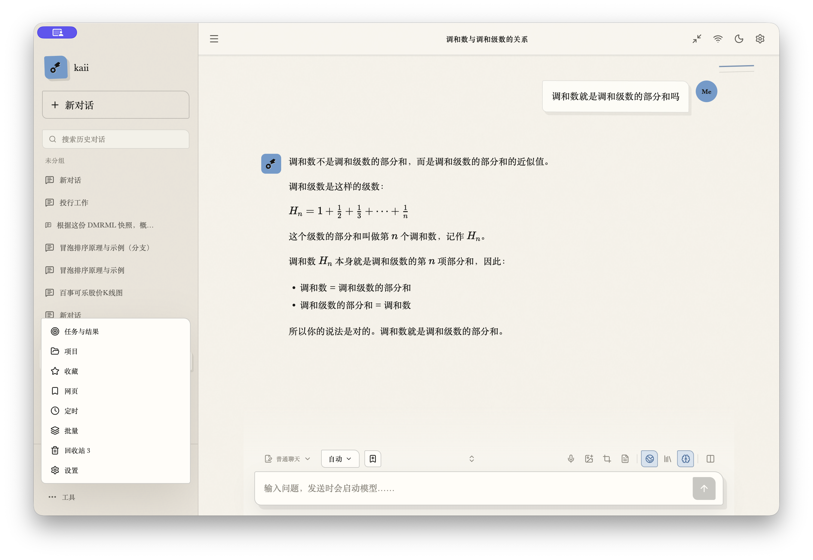

### 对话

Conversation

阅读回答时可以展开目录、继续提问，也可以将内容放进画布。

While reading a response, you can open its outline, ask follow-up questions, or move the content into the canvas.

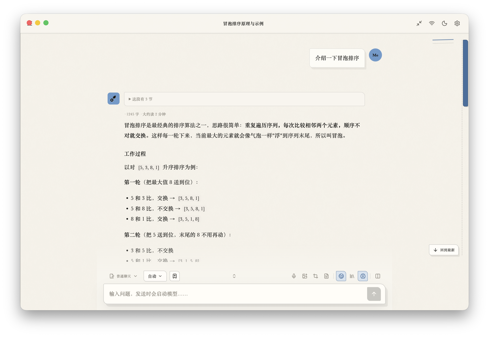

### 代码

Code

代码块支持语法高亮、行号、换行、复制和保存文件。

Code blocks support syntax highlighting, line numbers, line wrapping, copying, and saving to a file.

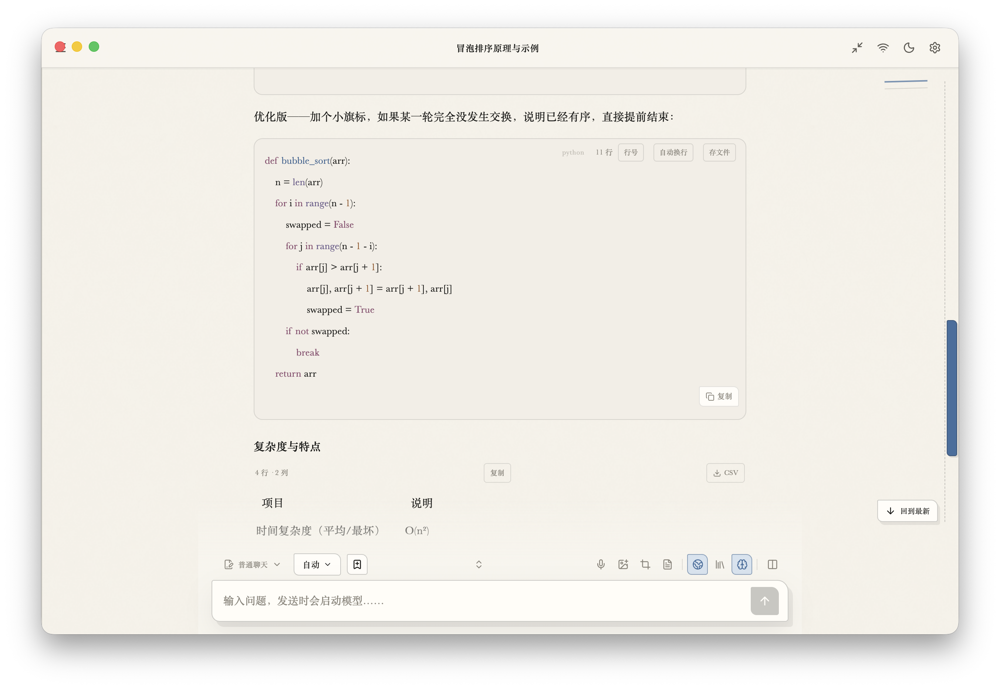

### 表格与回答操作

Tables and response actions

表格可以排序、复制或导出 CSV。回答下方提供收藏、改写、重新生成和分支入口。

Tables can be sorted, copied, or exported as CSV. Controls beneath a response provide access to favorites, rewriting, regeneration, and branching.

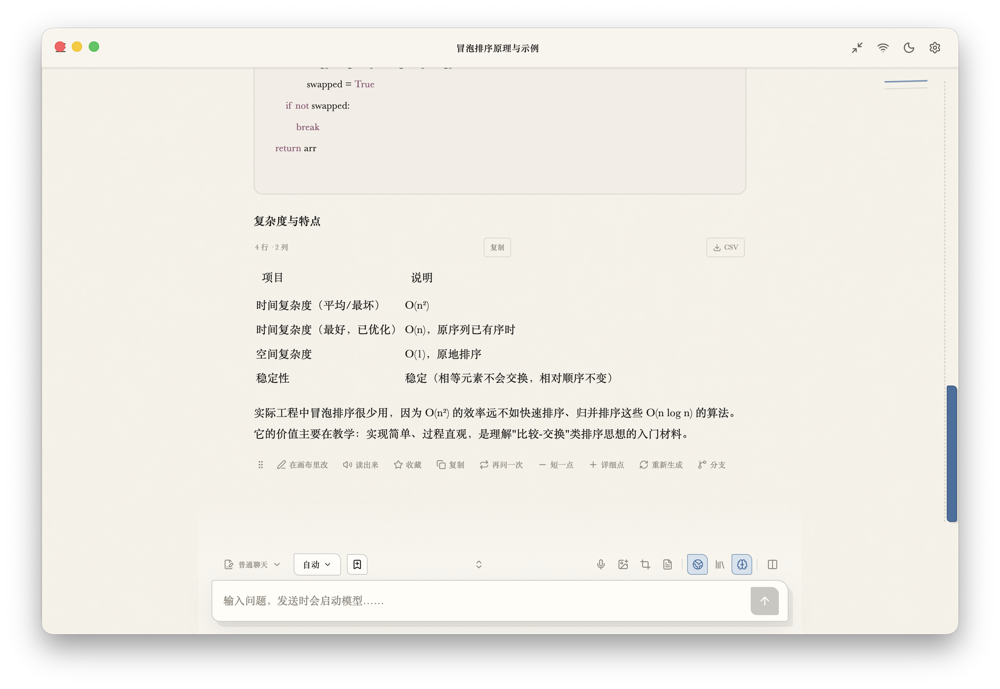

### 知识库

Knowledge libraries

从这里选择资料文件夹并建立索引。图中展示添加资料前的页面。

Choose a folder of materials here and build its index. The screenshot shows the page before materials have been added.

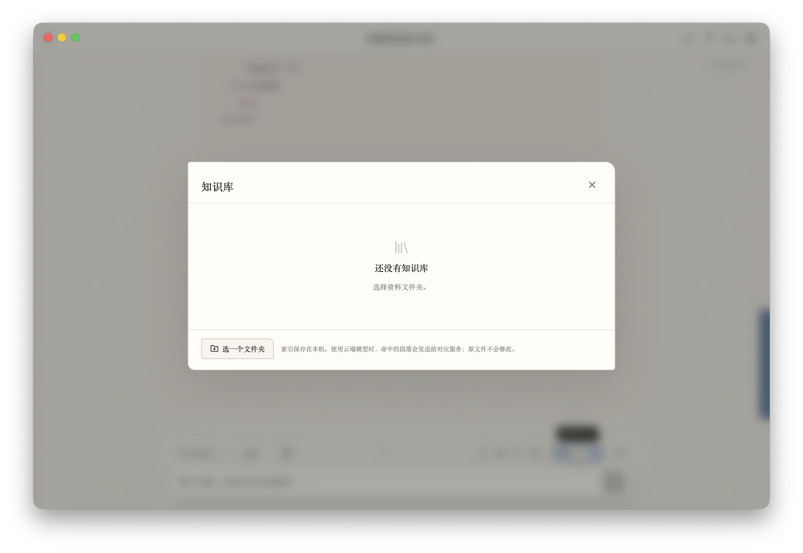

### 模型比较

Model comparison

选择模型后提交同一个问题，并排查看回答。图中展示开始比较前的页面。

Select models and submit the same question to view their responses side by side. The screenshot shows the page before a comparison begins.

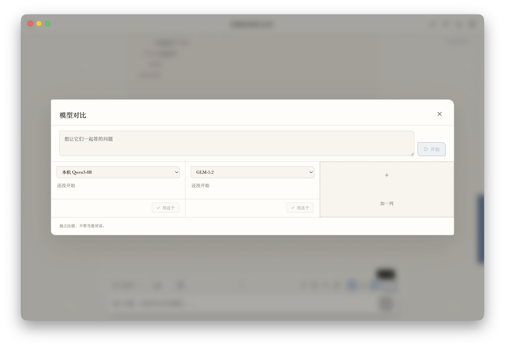

### 任务与结果

Tasks and results

在这里选择直接提问、分析材料或自动处理，并查看完成后的任务结果。图中展示结果列表为空时的页面。

Choose direct questions, material analysis, or automated processing here, and review completed task results. The screenshot shows an empty results list.

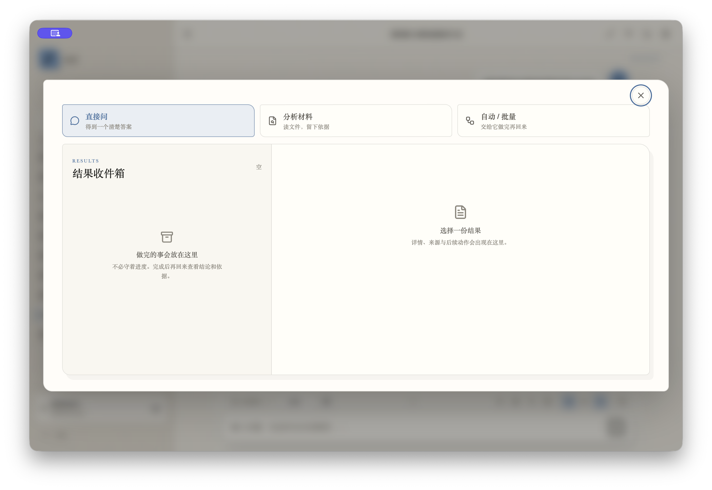

### 项目

Projects

按项目整理对话和资料。图中展示新建项目的入口。

Organize conversations and materials by project. The screenshot shows where to create a project.

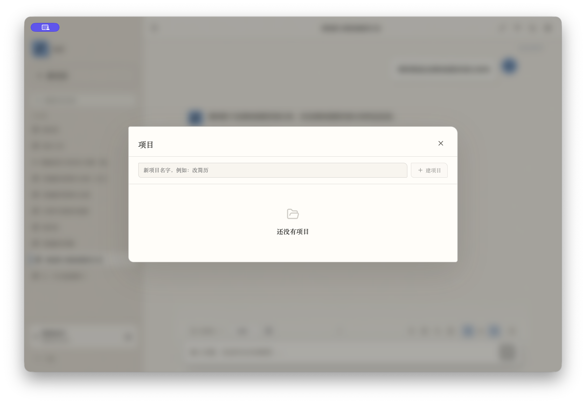

### 收藏

Favorites

集中查看收藏的回答。图中展示添加收藏前的页面。

View saved responses in one place. The screenshot shows the page before any favorites have been added.

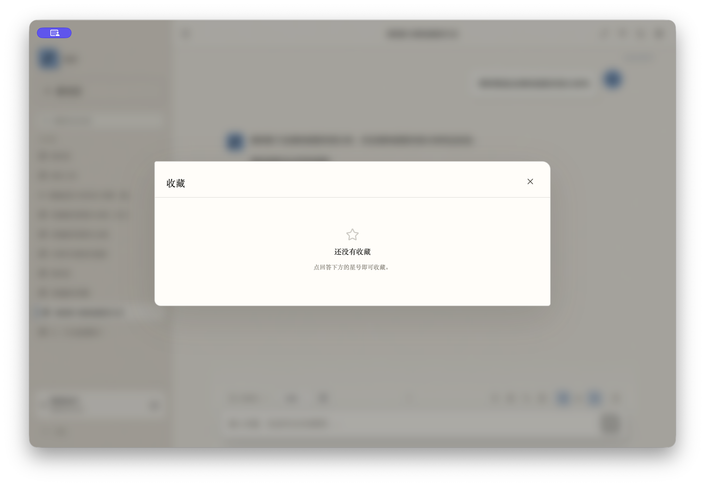

### 网页存档

Saved web pages

保存网页正文，之后可以阅读和提问。图中展示添加网页的入口。

Save the text of web pages to read and ask questions about later. The screenshot shows where to add a web page.

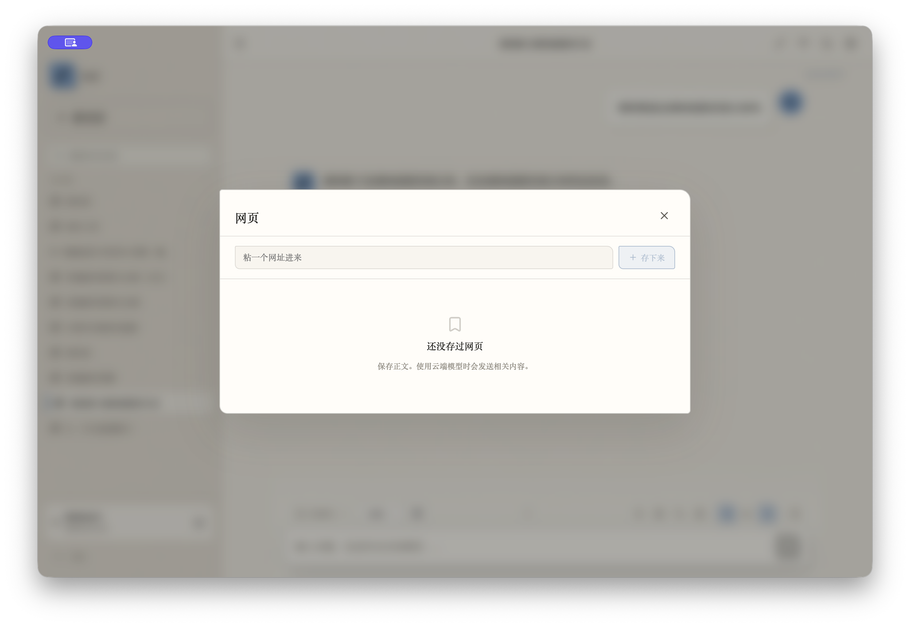

### 定时任务

Scheduled tasks

填写任务内容、执行时间和使用的模型，也可以从自然语言描述生成任务表单。图中展示任务创建页。

Enter the task, execution time, and model, or generate the task form from a natural-language description. The screenshot shows the task creation page.

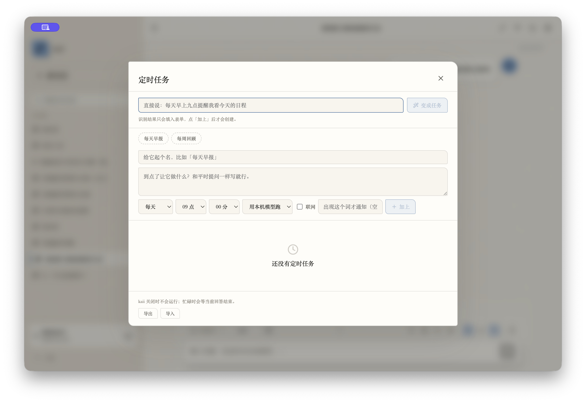

### 批量处理

Batch processing

将多条文本交给同一项操作，统一查看、复制和保存结果。图中展示输入内容前的页面。

Apply the same operation to multiple text items, then view, copy, and save the results together. The screenshot shows the page before content is entered.

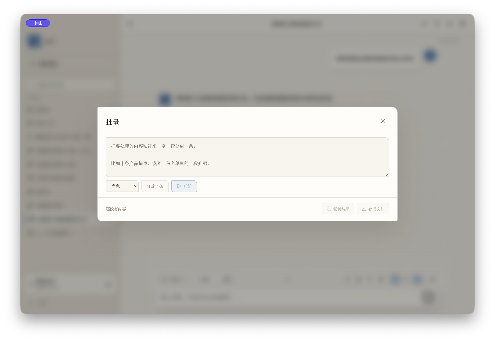

### 回收站

Trash

查看已删除的对话，选择恢复或彻底删除。

View deleted conversations and choose to restore or permanently delete them.

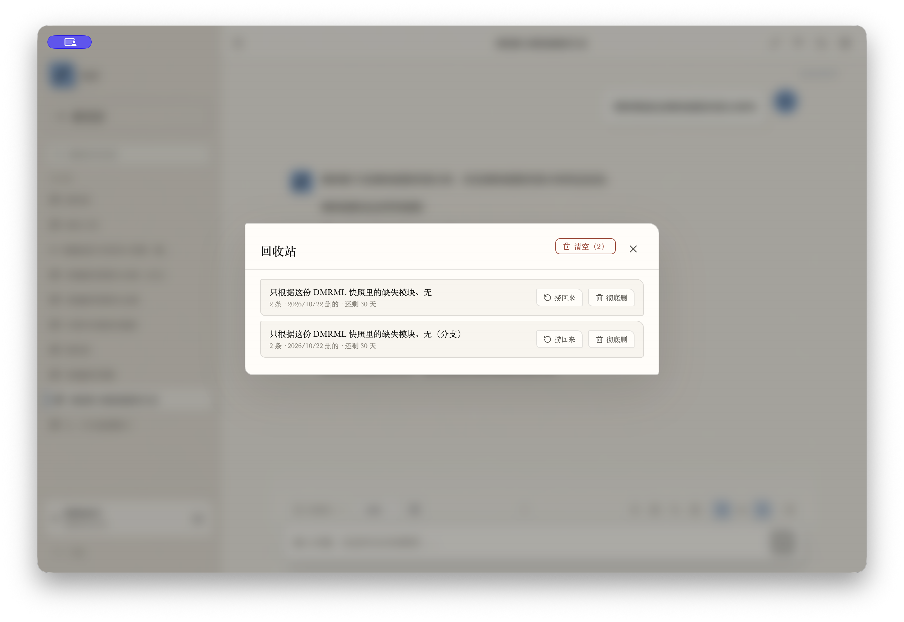

## 为什么开源

Why open source

我希望大家能直接使用 kaii-agent，也希望它能成为一个可供参考和个性化改造的 AI 桌面应用框架。你可以接入自己常用的模型，调整界面和提示词，增加工具，也可以参考其中的前端组件、文件处理和任务管理实现，做一个适合自己的助手。

I hope people can use kaii-agent directly, and I also hope it can serve as an AI desktop application framework to learn from and customize. You can connect the models you use, adjust the interface and prompts, add tools, or draw on its frontend components, file handling, and task management to build an assistant that suits you.

这套应用还有许多可以改进的地方。欢迎分享使用体验、提出具体问题，或提交自己的改动。感谢大家使用和参与。

There is still plenty to improve in this application. You are welcome to share your experience, raise specific issues, or contribute your own changes. Thank you for using it and taking part.

## 开始使用

Getting started

当前版本面向 macOS。从源码运行需要 Node.js 22.12 或更新版本，以及 Xcode Command Line Tools。

The current version targets macOS. Running from source requires Node.js 22.12 or later and Xcode Command Line Tools.

```bash
npm ci
npm run build:native
npm run dev
```

首次打开时选择一家模型服务并保存 API key，或点击“先浏览，稍后设置”。后续可以在设置中补充其他服务。API 调用按所选服务商的账户计费。

On first launch, choose a model service and save an API key, or select “Browse first, set up later.” You can add other services in Settings afterward. API calls are billed to your account with the selected provider.

本机模型需要准备 llama.cpp 的 `llama-server` 和 GGUF 权重，在设置中选择对应文件。内存占用随模型大小和上下文长度变化。

Local models require a llama.cpp `llama-server` executable and GGUF weights. Select the corresponding files in Settings. Memory usage varies with model size and context length.

API key 保存在本机应用数据目录的 `credentials.json`，文件权限为 `0600`。使用云端模型时，请求内容发送给相应服务商。

API keys are saved in `credentials.json` in the local application data directory, with file permissions set to `0600`. When a cloud model is used, request content is sent to the corresponding provider.

## 界面语言

Interface language

当前界面使用中文。下一步计划加入“跟随系统 / 简体中文 / English”选择，统一处理菜单、设置、弹窗、状态和快捷键提示。其他语言可以通过新增翻译文件扩展。界面语言与对话使用的语言分别设置。

The interface currently uses Chinese. The next step is to add “Follow system / Simplified Chinese / English,” covering menus, settings, dialogs, statuses, and shortcut hints consistently. Additional languages can be added through translation files. Interface language and conversation language will be configured separately.

## 代码从哪里看

Where to start in the code

| 目录<br>Directory | 内容<br>Contents |
| --- | --- |
| `src/` | React 界面、对话状态、画布和任务面板<br>React UI, conversation state, canvas, and task panels |
| `electron/` | 桌面窗口、模型调用、文件工具、调度和本机记录<br>Desktop windows, model requests, file tools, scheduling, and local records |
| `electron/lib/providers.cjs` | 服务商适配、凭据和模型清单<br>Provider adapters, credentials, and model lists |
| `electron/lib/agent-tools.cjs` | Agent 文件与命令工具<br>Agent file and command tools |
| `native/` | OCR、PDF 文本提取和语音输入的 Swift 源码<br>Swift source for OCR, PDF text extraction, and voice input |
| `harness/` | 使用演示数据的界面测试环境<br>UI test environment using demonstration data |
| `tests/` | 主进程、界面逻辑、原生工具与打包检查<br>Main-process, UI-logic, native-tool, and packaging checks |

继续开发可从[参与开发](CONTRIBUTING.md)、[应用结构](docs/ARCHITECTURE.md)和[Agent 与 Harness](docs/AGENT-HARNESS.md)开始。数据存储与执行权限见[安全说明](SECURITY.md)。

To continue development, start with [Contributing](CONTRIBUTING.md), [Architecture](docs/ARCHITECTURE.md), and [Agent and Harness](docs/AGENT-HARNESS.md). See [Security](SECURITY.md) for data storage and execution permissions.

采用 MIT 许可证，欢迎使用、修改和分享。

Released under the MIT license. You are welcome to use, modify, and share it.

作者 [ykkai-w](https://github.com/ykkai-w)。

Author [ykkai-w](https://github.com/ykkai-w).
