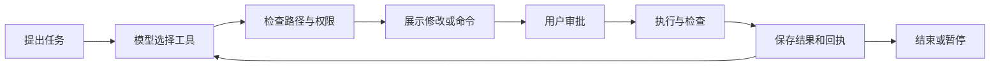

# Agent 与 Harness

kaii-agent 的 Agent 可以读取授权目录、搜索文件、提出修改并运行检查。用户能看到操作请求和执行结果，按需批准写入与命令。

## 一次任务怎样运行

云端模型可使用原生工具调用，本机模型可使用文字工具协议。已有工具包括目录查看、文件读取、搜索、计划、补丁和受控命令。

写入前保留修改预览。整体覆盖使用 SHA-256 前置条件，文件变动会影响后续执行。部分修改支持语法检查、失败恢复和任务级逆序回滚。命令运行设置超时、输出上限，并在取消后回收相关进程。

SQLite 保存运行记录、工具结果和检查点。任务完成状态区分模型结束、检查通过和等待处理；标记为 `verified` 需要最后一次修改之后有通过的检查。

## 执行权限

文件工具受授权目录约束。命令会以当前用户权限执行项目代码，可以访问该用户可见的系统资源和网络。对陌生项目保持逐次审批，需要更强隔离时应在独立环境里运行。

文件快照覆盖 kaii-agent 管理的文件变更。命令自行创建的外部资源与其他副作用，需要按具体任务处理。SQLite 记录用于查看过程，当前记录格式使用普通本机数据库。

## Harness 做什么

当前 `harness/` 提供界面回归环境。它使用演示数据与模拟事件运行真实前端，可以检查首次设置、空状态、应用锁、任务工作台和流式更新。

Agent 行为由 `tests/electron/` 中的用例检查，包括工具输入、审批、文件状态、取消和恢复。评估模型的任务成功率与成本时，还需要固定任务、模型版本、费用口径和验收条件，并保存每次实际运行的记录。

## 后续可拆出的部分

Agent 循环目前随桌面应用运行。进一步复用时，可以把模型、工具、工作区、审批和记录拆成五个接口，让桌面应用和命令行共用执行逻辑。Task Capsule 的纯数据结构与测试可作为较小的起点。
