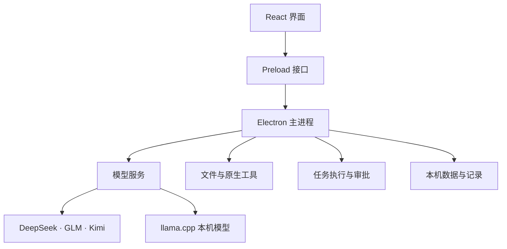

# 应用结构

kaii-agent 使用 Electron、React 和 TypeScript。界面负责组织任务，主进程负责调用模型、读写文件和保存记录。

## 界面与桌面进程

`src/` 包含对话、资料、画布、项目和任务工作台。`electron/preload.cjs` 为界面提供明确的调用接口，`electron/main.cjs` 处理窗口生命周期、模型流式事件、任务调度和各类本机操作。每个 IPC 入口校验来源与参数。

首次使用引导位于 `src/components/WelcomePanel.tsx`。用户可以保存一家模型服务的 key，也可以先进入浏览状态。浏览选择仅保存一个状态值；key 交给主进程的凭据模块处理。

## 模型与资料

`electron/lib/providers.cjs` 管理模型服务、请求参数、模型清单和凭据掩码。本机模型的生命周期由 `model-supervisor.cjs` 管理。

文档、图像和语音分别由 `document.cjs`、`image-analysis.cjs`、`speech.cjs` 处理。`native/` 中的三个 Swift 程序调用 macOS 框架完成 OCR、PDF 文本提取和端上听写。构建时从源码生成 helper。

## Agent 与记录

`agent.cjs` 和 `agent-tools.cjs` 定义工具协议与执行逻辑，`workspace.cjs` 管理授权目录，`audit.cjs` 保存运行记录、回执和检查点。界面的任务对象由 `src/lib/task-capsule.ts` 与 `task-store.ts` 管理。

命令以当前用户权限运行。文件工具的目录约束、命令审批和任务恢复分别接受测试，具体实现见 [Agent 与 Harness](AGENT-HARNESS.md)。

## 测试入口

`tests/` 覆盖主进程逻辑、界面状态、原生 helper 与构建产物。`harness/` 使用模拟 IPC 渲染真实界面，适合检查排版、键盘操作和事件更新。真实模型的调用结果需要单独运行带模型的用例并记录。
